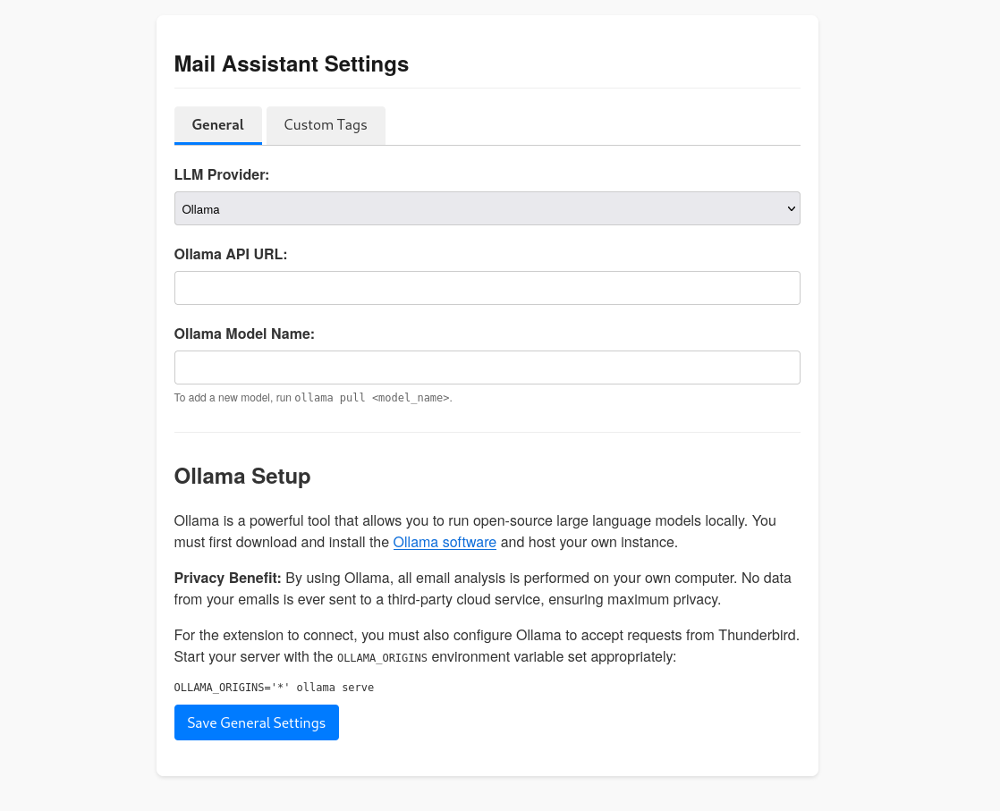
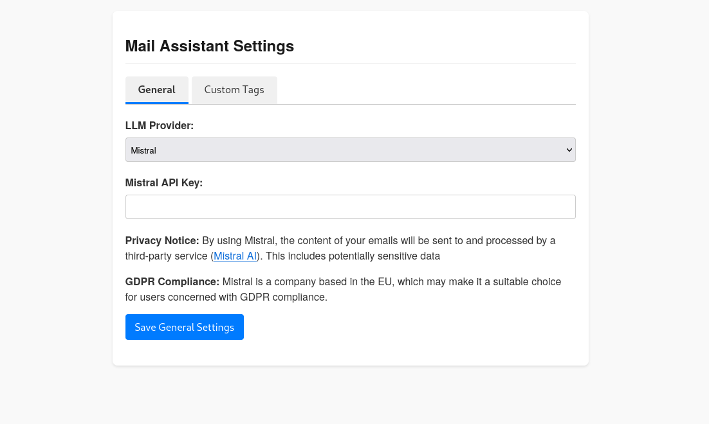
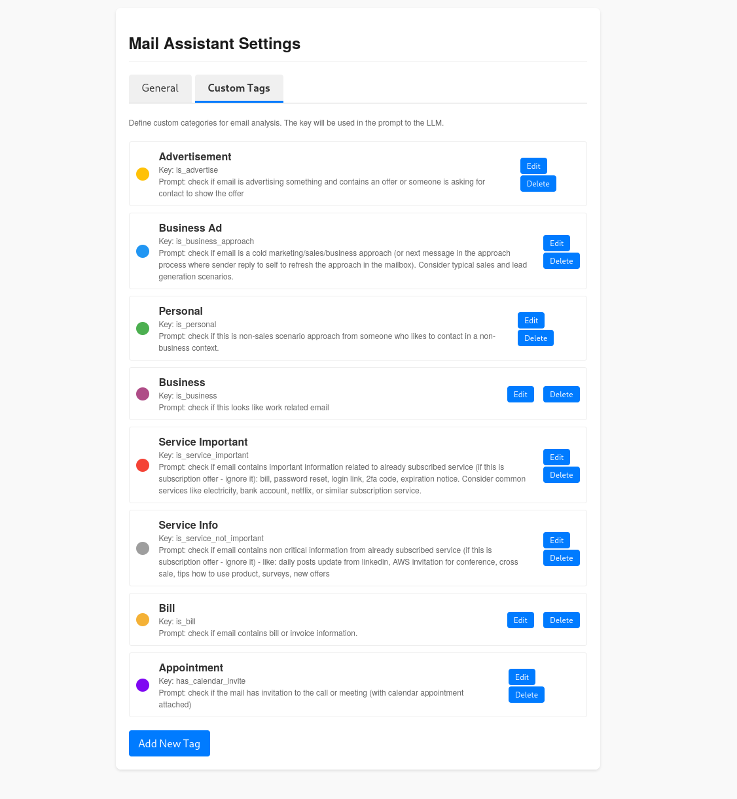
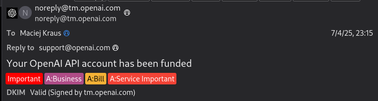

# Thunderbird Email AI Assistant

> AI-powered, multi-provider mail tagging and classification engine for Thunderbird.

Plugin page: https://addons.thunderbird.net/eN-US/thunderbird/addon/email-assistant/

This Thunderbird MailExtension provides a powerful and flexible framework for AI-powered email analysis. It automatically processes incoming emails, sends them to a language model of your choice for analysis, and then applies tags based on the model's response. This allows for sophisticated, automated email classification and sorting.

## Key Features

- **Multi-Provider LLM Support**: Ten providers — local models via Ollama plus OpenAI, Google Gemini, Anthropic Claude, Mistral, DeepSeek, OpenRouter (standard and confidence-gated "Decisions"), and ZAI (PaaS and Coding Plan).
- **Confidence Score Display**: Shows confidence scores (0-100%) alongside each tag suggestion, providing transparency into AI classification certainty.
- **Configurable Confidence Thresholds**: Allows users to set global and per-tag minimum confidence thresholds, ensuring tags are only applied when the AI is sufficiently confident.
- **Low-Confidence Flagging**: Flags emails with low-confidence classifications for manual review, giving users control over borderline cases.
- **Undo for Tag Changes**: Every tag change is recorded before it is applied; the "Tags rückgängig machen" entry in the message context menu restores the previous tag state. Undo failures are reported as errors instead of being silently treated as "no history".
- **Folder Batch Analysis**: The "Analysiere diesen Ordner" context-menu entry analyzes all messages in a folder with a live toolbar progress badge. The result status distinguishes `success`, `partial` (some messages failed), and `error`, so unprocessed mails are never reported as success.
- **Debug Tab**: The options page includes a Debug tab with live queue and batch status, the recent tag-apply history (Tag-Verlauf, clearable), and a debug log viewer with level filter and download.
- **Notifications**: Toolbar and context-menu actions report start, completion, and errors via Thunderbird notifications.
- **Dynamic Email Analysis**: Intelligently extracts headers, text content (converting HTML to plain text), and attachment details for efficient and accurate analysis by the LLM.
- **Prompt Hardening**: The mail body is treated as untrusted data in the prompt, code fences are stripped so the body cannot break out of its section, and the body is hard-capped at 25,000 characters (cost protection).
- **Fully Configurable Tagging**: Allows users to define their own custom tags, colors, and LLM prompts for a completely personalized email classification system.
- **Privacy-Focused**: Gives users the choice between maximum privacy with a local Ollama instance (restricted to `localhost`/`127.0.0.1`) or cloud-based models, with clear privacy notices for each.
- **Secure Configuration**: Features a comprehensive options page for managing API keys and provider settings. No API host permissions are granted upfront; they are requested at runtime when you configure a provider.

## Architecture

This extension follows **Hexagonal Architecture** (also known as Clean Architecture or Ports & Adapters) with **Dependency Injection** using [TSyringe](https://github.com/microsoft/tsyringe). This design ensures:

- **Testability**: Easy mocking of external dependencies
- **Maintainability**: Clear separation of concerns
- **Flexibility**: Easy to swap implementations (e.g., different LLM providers)

### Layer Structure

```
┌─────────────────────────────────────────┐
│           Interfaces (Entry)            │  Thunderbird integration, UI components
├─────────────────────────────────────────┤
│          Application (Use Cases)        │  Orchestration, business workflows
├─────────────────────────────────────────┤
│            Domain (Business)            │  Entities, Value Objects, Services
├─────────────────────────────────────────┤
│        Infrastructure (External)        │  LLM providers, cache, storage
└─────────────────────────────────────────┘
```

**Dependency Rule**: Inner layers never depend on outer layers. Domain has no dependencies.

### Project Structure

```
src/
├── background/          # Background module: BackgroundScript, DIContainer, menu/toolbar handlers
├── domain/              # Core business logic
│   ├── entities/        # Email, Tag
│   ├── value-objects/   # EmailAddress, ApiKey, TagColor, ...
│   ├── services/        # TagService, EmailContentExtractor
│   ├── interfaces/      # ILogger, ITagManager, IClock, IRandom
│   └── errors/          # Domain error types
├── application/         # Use cases & orchestration
│   ├── use-cases/       # AnalyzeEmail, ApplyTagsToEmail, UndoTagChanges, AnalyzeBatchEmails, ...
│   └── services/        # PriorityQueue, RateLimiterService, EmailAnalysisTracker
├── infrastructure/      # External integrations
│   ├── providers/       # 10 LLM providers (impl/) + BaseProvider, ProviderFactory, PromptBuilder
│   ├── cache/           # MemoryCache, AnalysisCache
│   ├── storage/         # TagHistory-, TagApplyHistory-, MetricsRepository
│   ├── repositories/    # StorageLocalConfigRepository (browser.storage.local)
│   ├── logger/          # ConsoleLogger, DebugLogBuffer
│   └── system/          # SystemClock, CryptoRandom
├── interfaces/          # Entry points & adapters
│   ├── background/      # EmailEventListener, MessageHandler
│   ├── options/         # DebugTab component
│   ├── adapters/        # ThunderbirdTagManager, ThunderbirdMailReader
│   └── shared/          # UI components, styles, ProviderSettingsService
└── shared/              # Cross-cutting concerns
    ├── types/           # TagTypes, ProviderTypes, Metrics, TagHistory
    ├── errors/          # DomainError, InfrastructureError, ApplicationError
    ├── constants/       # PromptConstants, TagConstants
    └── utils/           # loggingUtils, validationUtils, confidenceUtils
```

The extension entry points are `background.ts` (bootstraps the DI container and delegates to `src/background/`) and `options.ts` (options page logic, including the Debug tab component).

### Key Design Patterns

| Pattern          | Implementation                              | Purpose                                        |
| ---------------- | ------------------------------------------- | ---------------------------------------------- |
| **Factory**      | `ProviderFactory`                           | Resolves LLM provider instances based on config |
| **Adapter**      | `BaseProviderAdapter`, Thunderbird adapters | Bridge provider/UI implementations to ports    |
| **Repository**   | `TagHistoryRepository`, `MetricsRepository` | Abstract storage operations                    |
| **Strategy**     | Provider implementations                    | Swappable LLM backends                         |
| **Value Object** | `EmailAddress`, `ApiKey`                    | Immutable, validated domain concepts           |

### Supported LLM Providers

| Provider                          | ID                       | Notes                                                            |
| --------------------------------- | ------------------------ | ---------------------------------------------------------------- |
| **Ollama**                        | `ollama`                 | Local inference, no API costs; accepts only localhost/127.0.0.1 URLs |
| **OpenAI**                        | `openai`                 | Cloud API                                                        |
| **Anthropic Claude**              | `claude`                 | Cloud API                                                        |
| **Google Gemini**                 | `gemini`                 | Cloud API                                                        |
| **Mistral**                       | `mistral`                | Cloud API                                                        |
| **DeepSeek**                      | `deepseek`               | Cost-effective cloud option                                      |
| **OpenRouter**                    | `openrouter`             | Multi-model gateway                                              |
| **OpenRouter Decisions**          | `openrouter-decisions`   | Confidence-gated decisions; optional `tagThreshold` per provider  |
| **ZAI PaaS**                      | `zai-paas`               | Z.ai PaaS endpoint                                               |
| **ZAI Coding**                    | `zai-coding`             | Z.ai Coding Plan endpoint                                        |

### Architecture Features

- **Performance Monitoring**: Tracks analysis duration, token usage, and estimated costs
- **Undo Mechanism**: Reverts tag changes with per-message history (recorded before each change)
- **Confidence Scores**: Tags include 0-100% confidence with global and per-tag threshold filtering
- **Reliable Batch Runs**: Batch results report `success`, `partial`, or `error`; skipped and failed messages never count as success
- **Fail-Loud Error Handling**: Unparseable LLM responses and unreadable configuration raise errors instead of producing fake successes or silent defaults

For detailed architecture decisions, see [docs/adr/](docs/adr/).

## Configuration and Usage

After installing the add-on, you can configure it by going to `Tools > Add-ons and Themes`, finding "Email Assistant", and clicking the "..." button to select **Options**.

### Permissions

The extension is granted no network access upfront (`host_permissions` is empty). When you save a provider configuration, the options page asks Thunderbird at runtime for permission to reach that provider's API host (optional host permissions). Upgrading from a 1.0.4 build requires confirming this prompt once per configured provider (see [CHANGELOG.md](CHANGELOG.md) migration notes). For Ollama, permission is requested for the configured local host; only `http://localhost`, `http://127.0.0.1` (and their HTTPS variants) are accepted, on any port.

### General Settings

The General tab allows you to select your preferred LLM provider and enter the necessary credentials (API Key or local URL).


_Ollama provider settings, with fields for a local URL and model name._


_Settings for a cloud provider like Mistral, requiring an API key._

### Custom Tags

The Custom Tags tab is where you can define the categories for email analysis. You can add, edit, or delete tags. Each tag has a name, a unique key, a color, and a specific prompt instruction that tells the LLM what to check for.


_The interface for managing custom tags._

### Confidence Thresholds

The Confidence Thresholds settings allow you to control when tags are automatically applied based on the AI's certainty level. This feature helps prevent incorrect classifications by only applying tags when the AI is confident enough.

**Global Threshold**: Set a default confidence threshold (0-100%) that applies to all tags. The default is 70%. Tags with confidence below this threshold will not be automatically applied.

**Per-Tag Override**: Override the global threshold for specific tags. For example, you might require a higher confidence (e.g., 85%) for important tags like "Urgent" while allowing lower confidence (e.g., 60%) for less critical tags.

**Visual Indicators**:

- Green badge (≥80%): High confidence
- Yellow badge (70-79%): Medium confidence
- Red badge (<70%): Low confidence

**Manual Review**: Emails with tags below your confidence threshold are flagged for manual review. You can access these via the "Manual Review" (Manuelle Überprüfung) tab in the options page, where you can choose to apply or dismiss each tag suggestion.

### Debug Tab

The Debug tab shows the current processing-queue statistics, the status of a running folder batch analysis (including cancel), the recent tag-apply history with an option to clear it, and the debug log buffer with a level filter and download.

### Usage

Once configured, the extension will automatically process new incoming emails. You can also analyze the displayed message via the toolbar button ("AI-Analyse"), single messages from the message list via the context menu, undo the last tag change per message ("Tags rückgängig machen"), or analyze an entire folder ("Analysiere diesen Ordner"). The applied tags can then be used with Thunderbird's built-in Message Filters to organize your inbox.

### Organizing emails

Once automated tagging is working, you may create filters that will move tagged messages to folders or take other actions. You should set those filters to run
periodically, as tagging is executed after initial filtering.


_An example of an email that has been automatically tagged by the assistant._

## Development

### Prerequisites

- **Node.js and npm**: Required for managing dependencies and running build scripts. You can download them from [nodejs.org](https://nodejs.org/).
- **Thunderbird**: The application this extension is built for.

### Build Instructions

1.  **Clone the repository:**

    ```bash
    git clone https://github.com/mcj-kr/thunderbird-email-ai-assistant.git
    cd thunderbird-email-ai-assistant
    ```

2.  **Install dependencies:**

    ```bash
    npm install
    ```

3.  **Common commands:**

    ```bash
    npm run build         # Production webpack build
    npm run build:dev     # Development build
    npm run type-check    # TypeScript check without emit
    npm test              # Run all tests (Vitest)
    npm run lint          # ESLint check
    npm run format        # Prettier
    ```

4.  **Package the extension:**
    This command runs webpack to bundle the scripts and then uses `web-ext` to package everything into a `.zip` file located in the `web-ext-artifacts/` directory.
    ```bash
    ./build.bash
    ```

## Installation

### Adding plugin

Install plugin from: https://addons.thunderbird.net/eN-US/thunderbird/addon/email-assistant/

### Temporary Installation (for Development)

1.  Build the extension using the instructions above.
2.  In Thunderbird, go to `Tools > Add-ons and Themes`.
3.  Click the gear icon, select `Debug Add-ons`, and then click `Load Temporary Add-on...`.
4.  Select the generated `.zip` file from the `web-ext-artifacts/` directory.
